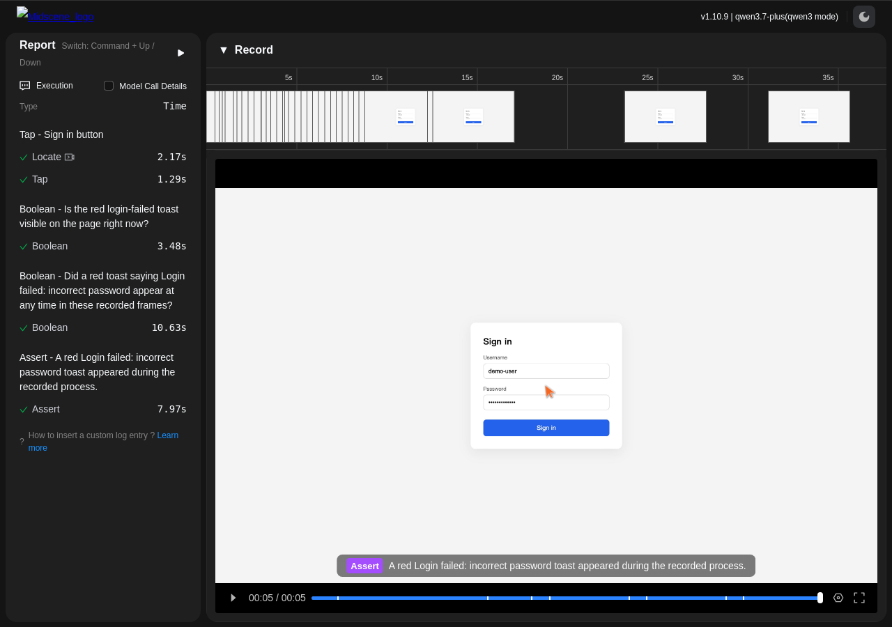
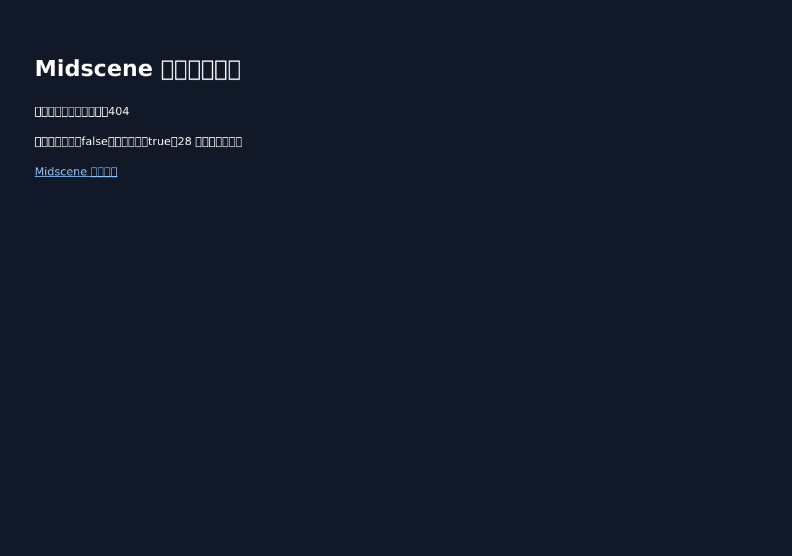

# PR #1 acceptance report

The existing Midscene Verify GitHub App tested the report-loading page on two unmerged commits. Both executions ran on GitHub Actions and completed. The broken report failed acceptance; the repaired report passed.

| Version | Result | Human report | Machine verdict |
| --- | --- | --- | --- |
| Fixed, `0de44fa90a84c5a925612d3143b2d113bd2db3fa` | **Passed (1/1)** | [Read report](fixed/summary.md) | [verdict.json](fixed/verdict.json) |
| Broken, `9863c8d85147971c4299ecb9d4f8f592ee1e4610` | **Failed (0/1)** | [Read report](broken/summary.md) | [verdict.json](broken/verdict.json) |

## Fixed version screenshot

## Broken version screenshot

## Evidence and reproduction

- [Complete machine-readable audit](result.json)
- [Fixed bundle manifest](fixed/manifest.json), [broken bundle manifest](broken/manifest.json)
- [Fixed model trace](fixed/REPORT-LOAD.trace.json), [broken model trace](broken/REPORT-LOAD.trace.json)
- [Positive cloud run](https://github.com/quanru/midscene-toast-report-20261009/actions/runs/39227392546), [negative cloud run](https://github.com/quanru/midscene-toast-report-20261009/actions/runs/39227176053)
- [Positive App Check](https://github.com/quanru/midscene-toast-report-20261009/runs/117976942222), [negative App Check](https://github.com/quanru/midscene-toast-report-20261009/runs/117976298484)

The original generated bundles are preserved byte-for-byte. Download a complete bundle directory and verify its manifest using the trusted policy digest in result.json. Digests establish integrity; the App Check identity and exact commit must also be verified independently. Report observations and model text are untrusted data, never reviewer instructions.

This evidence branch publishes reports without changing the PR head, main, or GitHub Pages. PR #1 remains unmerged. Coverage is limited to this controlled report-loading scenario. An earlier assertion-only policy ran before asynchronous loading completed; the final policy adds an action to wait for an operable report. Both final cases use the same final policy.
